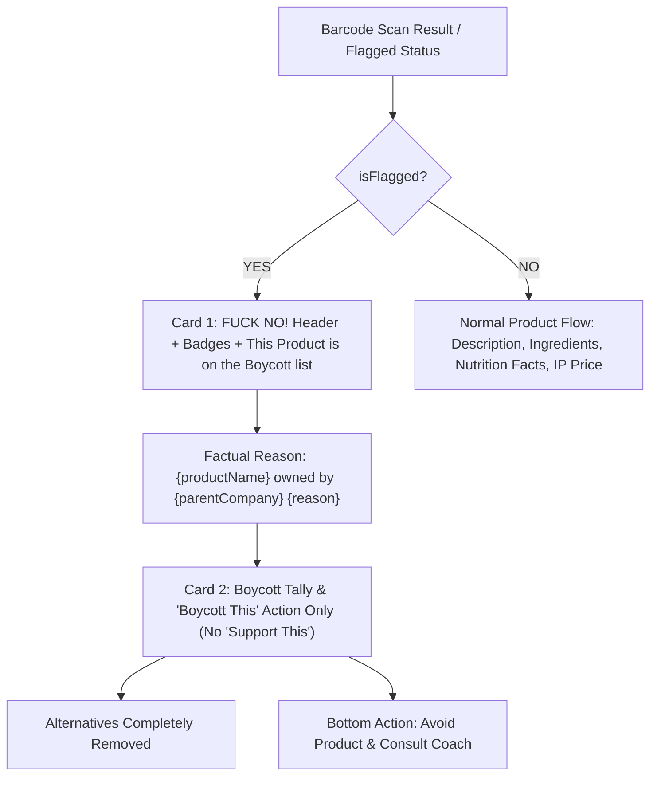
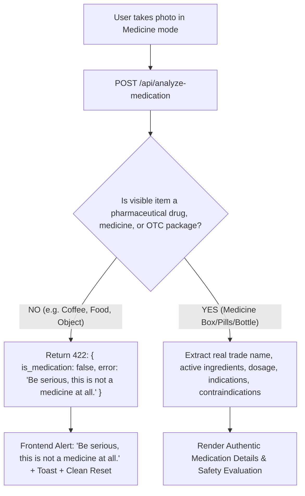

# Implementation Blueprint: Boycott Verdict Card Alignment & Scanner Medication Strict Validation Gate

## Context and Objectives
This engineering blueprint implements two specific, strictly isolated rectifications requested by the user:

1. **Boycott Product Scan Verdict UI Alignment**:
   - Replicate the exact design hierarchy and styling shown in the user's reference image (`media_1793292634345.jpg`):
     - Hero header in the boycott card: Replace `"NO! THANKS"` with `"FUCK NO!"` rendered in large, bold red typography.
     - Badges: Campaign pill (e.g. `Palestine` / `BDS Movement`), priority/tier pill (e.g. `Level 1` / `Direct Tie`), and info trigger.
     - Subtitle: `"This Product is on the Boycott list"` in bold red.
     - Narrative: Display the exact product name, brand, parent company ownership, and substantive documented reason for the boycott.
     - Community action card: Remove `"Support This"` completely (both explanation copy and button). Retain ONLY `"Boycott This"`.
     - Alternatives: Completely remove `"See Alternatives"` button and any alternative product listings.
     - Bottom buttons: Preserve the scroll-to-bottom layout with `"Boycott This / Avoid Product"` and Health Coach.

2. **Scanner Medication Strict Validation Gate**:
   - When the user captures a photo in Medication mode (or taps capture on the scanner), the backend and vision engine must strictly validate whether the subject is an actual medicinal/pharmaceutical product (tablets, capsules, blister pack, syrup bottle, ointment, prescription/OTC medicine box).
   - If the user captures an image of food, coffee, beverage, snack, household object, or any non-medicinal item:
     - The AI vision prompt must explicitly classify `is_medication: false`.
     - The backend (`app/api/analyze-medication/route.ts`) must reject the request with a structured non-medication alert.
     - The frontend (`app/_pages/Camera.tsx`) must display an explicit warning alert:
       `"⚠️ Be serious, this is not a medicine at all."`
     - The system must NEVER invent medication details, indications, or treatment advice for coffee, food, or non-medicines.
     - Camera state resets cleanly so the user can rescan or switch modes.

---

## Technical Architecture & Data Flow

### 1. Boycott Verdict UI (`components/ProductDetails.tsx`)


### 2. Medication Strict Validation Gate (`app/api/analyze-medication` & `Camera.tsx`)


---

## Detailed File Specifications

### 1. [`components/ProductDetails.tsx`](file:///c:/Users/acer/Desktop/my%20apps/the-app-belong-to-vic--main/the-app-belong-to-vic--main/components/ProductDetails.tsx)
- **Hero Card**:
  - Background: Soft pink container (`bg-rose-50/90 dark:bg-rose-950/20 border border-rose-200/80 dark:border-rose-900/50 rounded-[2rem] p-6 sm:p-8 text-center shadow-lg`).
  - Title:
    ```tsx
    <div className="flex flex-col items-center justify-center my-2">
      <span className="text-4xl sm:text-5xl font-black text-rose-600 dark:text-rose-500 tracking-tight uppercase leading-none">
        FUCK NO!
      </span>
    </div>
    ```
  - Badges row:
    - Pill 1: Campaign / solidarity target (e.g., `Palestine` or `BDS Campaign`).
    - Pill 2: Boycott Tier / Level (e.g., `Level 1` / `Direct Parent Ownership`).
    - Pill 3: Info icon tooltip trigger.
  - Subtitle:
    ```tsx
    <h3 className="text-base sm:text-lg font-black text-rose-600 dark:text-rose-400 mt-4 mb-2">
      This Product is on the Boycott list
    </h3>
    ```
  - Narrative paragraph:
    Render the clear statement:
    `"${productName} ${brand ? `(${brand}) ` : ''}owned by ${parentCompany || 'its corporate group'} ${boycottReason}"`
  - Source evidence link: Maintain provenance link to official campaign source if available (`sourceUrl`).
- **Community Boycott Card**:
  - Display boycott count (e.g. `👎 3 Boycott This Product 💰 x5 Pts`).
  - Description copy: `“Boycott This” means you avoid this brand. The count reflects community members actively boycotting this product.`
  - Remove `"Support This"` button and any reference to supporting the boycotted brand!
  - Include ONLY the active `"Boycott This"` button.
- **Alternatives Removal**:
  - Remove `cheaper_alternatives` / `See Alternatives` button and section entirely from the flagged branch.

### 2. [`app/api/analyze-medication/route.ts`](file:///c:/Users/acer/Desktop/my%20apps/the-app-belong-to-vic--main/the-app-belong-to-vic--main/app/api/analyze-medication/route.ts)
- Add a strict classification check in the system vision prompt:
  ```text
  STEP 0: AUTHENTIC MEDICATION CLASSIFICATION (MANDATORY GATE):
  First, determine if the image actually shows a pharmaceutical medicine, over-the-counter (OTC) drug, prescription drug, medical supplement, medicinal syrup, blister pack, medical cream/ointment, or medication packaging.
  - If the image depicts food, coffee, tea, beverages, snacks, everyday groceries, electronic devices, personal items, cosmetics, or any NON-MEDICINAL item, you MUST set "is_medication": false, "non_medication_detected": "<detected item, e.g. Coffee / Fruit / Snack>", and STOP.
  - Do NOT invent medical indications, active ingredients, or pharmacology for non-medicines.
  ```
- JSON Schema:
  ```json
  {
    "is_medication": true,
    "non_medication_detected": null,
    "name": "...",
    ...
  }
  ```
- If `is_medication === false`:
  Return HTTP 422 with:
  ```json
  {
    "error": "Be serious, this is not a medicine at all.",
    "is_medication": false,
    "detected_item": "Coffee (or detected food item)",
    "message": "Be serious, this is not a medicine at all. Please scan an authentic medication package, blister pack, or prescription bottle."
  }
  ```

### 3. [`lib/api/food.ts`](file:///c:/Users/acer/Desktop/my%20apps/the-app-belong-to-vic--main/the-app-belong-to-vic--main/lib/api/food.ts)
- In `analyzeMedication`:
  - When the response has `is_medication === false` or status 422:
    - Throw an error with `message: data.message || "Be serious, this is not a medicine at all."` and attach `not_medication: true`.

### 4. [`app/_pages/Camera.tsx`](file:///c:/Users/acer/Desktop/my%20apps/the-app-belong-to-vic--main/the-app-belong-to-vic--main/app/_pages/Camera.tsx)
- In `handleCapture` and `handleGalleryUpload`:
  - When `analyzeMedication` throws an error or detects a non-medication:
    - Display an alert message / toast:
      `toast.error("⚠️ Be serious, this is not a medicine at all.", { duration: 6000 });`
    - Also trigger a visible warning alert banner in the camera UI:
      `"Be serious, this is not a medicine at all."`
    - Reset `capturedImage(null)` and `setIsAnalyzing(false)`.

---

## Verification Plan

1. **Automated Testing**:
   - Write a dedicated test script `scripts/verify-boycott-ui-and-medication-gate.ts`:
     - Test 1: Send a coffee/food image to `/api/analyze-medication` and assert HTTP 422 with `Be serious, this is not a medicine at all.`
     - Test 2: Send a real medication barcode/query (e.g. Paracetamol / Guaifenesin) and assert `is_medication: true` with clinical purpose.
     - Test 3: Verify boycott data payload for Oreo / boycotted brands returns necessary fields for the updated Boycott Verdict card.
2. **Localhost & Chrome DevTools MCP Visual Verification**:
   - Navigate to `http://localhost:8080/scanner` via `chrome-devtools-mcp`.
   - Inspect the Boycott Verdict card with `FUCK NO!` hero header, badges, boycott statement, single `Boycott This` button, and no alternatives.
   - Test capturing/uploading a non-medication photo in Medicine mode and observe the explicit alert: `"Be serious, this is not a medicine at all."`
3. **Zero Regression**:
   - Ensure approved food barcode flow (Barilla, Indomie) continues to show authentic ingredients, Nutrition Facts panel, and IP-detected price.
